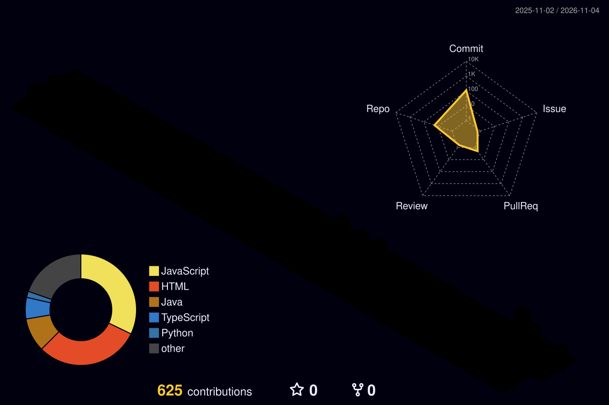

<div align="center">


<a href="https://git.io/typing-svg"></a>

<p>
  <a href="https://chaitanya.veltore.co.in"></a>
  <a href="https://www.linkedin.com/in/chaitanya-yelamasetty"></a>
  <a href="mailto:chaitanyachowdary4e3@gmail.com"></a>
  
  
</p>

</div>

```yaml
# $ whoami
name:        Chaitanya Yelamasetty
role:        Full-stack engineer · AI-native
location:    Bengaluru, India · open to Hyderabad or remote
experience:  2.8 years in production
now:
  - building GarvSe 2.0, an offline-first accessible platform used by field teams across India
  - building AI agent products: DevOps + security agent, job-application agent, data-deletion audit agent
how_i_work:
  - Claude Code for implementation, refactors, audits and tests; the test suite and code review are the gate
  - local models via Ollama wherever data must stay on the machine
  - every agent stops for human approval before anything irreversible
stack:       [TypeScript, Node.js, React, PostgreSQL, Tauri, Python, Docker, AWS]
learning:    [AI safety and control for coding agents, Rust]
```

<div align="center">


</div>


<div align="center">
  <picture>
    <source media="(prefers-color-scheme: dark)" srcset="./profile-3d-contrib/profile-night-rainbow.svg" />
    <source media="(prefers-color-scheme: light)" srcset="./profile-3d-contrib/profile-season-animate.svg" />
    
  </picture>
</div>

<sub>Regenerated nightly by a GitHub Action; private contributions are counted without exposing repository names.</sub>


<div align="center">
  <picture>
    <source media="(prefers-color-scheme: dark)" srcset="https://raw.githubusercontent.com/Chaitanyachaowdary/Chaitanyachaowdary/output/github-contribution-grid-snake-dark.svg" />
    <source media="(prefers-color-scheme: light)" srcset="https://raw.githubusercontent.com/Chaitanyachaowdary/Chaitanyachaowdary/output/github-contribution-grid-snake-ocean.svg" />
    
  </picture>
</div>

<div align="center"><a href="https://git.io/typing-svg"></a></div>


<table>
  <tr>
    <td width="50%" valign="top">
      <h3>🛡️ Kanna DevOps Agent</h3>
      <p>DevOps mentor and security architect in one agent: reviews infrastructure, runs <b>read-only</b> diagnostics, secret scanning and posture reviews. Defence-in-depth by design.</p>
        
    </td>
    <td width="50%" valign="top">
      <h3>🧭 Job-apply Agent</h3>
      <p>Finds roles, tailors a resume with a <b>local model</b>, fills applications from a fixed profile and <b>stops for human approval</b> before any submit. Review dashboard included.</p>
         
    </td>
  </tr>
  <tr>
    <td width="50%" valign="top">
      <h3>🔍 Ghost-data Audit Agent</h3>
      <p>Evidence-grounded agent that proves whether personal data was <b>really</b> deleted. Orchestrated local agents, <b>99.2% step F1</b> on samples. HackerRank Orchestrate, Oct 2026.</p>
        
    </td>
    <td width="50%" valign="top">
      <h3>🏢 Humara HRMS</h3>
      <p>Multi-tenant, India-first HRMS with a <b>local AI assistant</b> in development.</p>
         
    </td>
  </tr>
</table>

<sub>These repositories are private; happy to walk through any of them.</sub>


| | |
|---|---|
|  | Claude Code drafts, I review every diff, run the suites (2,100+ backend, 4,200+ frontend tests) and own what ships |
|  | One agent-driven audit of sync, upload and access-control paths: **20 verified defects**, all fixed, tested and ticketed in a day |
|  | Ollama (Qwen) for anything that touches personal or client data; nothing leaves the machine |
|  | LLM text simplification and a voice assistant in a production accessibility widget; AI-assisted KYC demo |
|  | Human approval before irreversible actions, audit logs, every output traceable to a source |


<div align="center">


</div>

-  desktop, Android and iOS: local SQLite mirror + sync queue with idempotent replays, per-row failure handling, tombstones for server deletes
-  WCAG 2.2 AA from the first sprint; many daily users are blind field officers
-  of 5,131 candidates from the legacy system, reconciled one by one
-  a 21-minute outage, Postgres JIT slow pages, a 3-day email outage, all root-caused and fixed
-  Built at CodeSage India, deployed to EnableIndia; code lives in a private organisation


| | Project | What it does |
|---|---|---|
| 💳 | [**SahajLoan**](https://github.com/Chaitanyachaowdary/SahajLoan) | Accessible loan + KYC demo; the model only ever sees a mismatch category, never a name. Razorpay × Replit Buildathon, Sep 2026<br/>   |
| 🎙️ | [**Kanna**](https://github.com/Chaitanyachaowdary/Kanna) | Android AI assistant: wake-word, Gemini replies, encrypted Room history, key in the keystore<br/>   |
| 🔗 | [**TINYLINK**](https://github.com/Chaitanyachaowdary/TINYLINK) | URL shortener with per-link stats · [live](https://tinylink-phi.vercel.app)<br/>   |
| 📝 | [**omnify-blog-fullstack**](https://github.com/Chaitanyachaowdary/omnify-blog-fullstack) | Full-stack blog: React + TypeScript frontend on a Java Spring Boot REST backend · [live](https://omnify-blog-fullstack.vercel.app)<br/>   |
| 🎓 | [**EnableU**](https://github.com/Chaitanyachaowdary/EnableU) | Accessibility-first learning platform: dyslexia-friendly type, AA contrast, keyboard-only navigation<br/>   |
| ❓ | [**easyq-qa-service**](https://github.com/Chaitanyachaowdary/easyq-qa-service) | AI-powered Q&A backend<br/>  |


<div align="center">

<a href="https://git.io/typing-svg"></a>
<br/><br/>
<a href="https://skillicons.dev"></a>
<br/>
<a href="https://skillicons.dev"></a>
<br/>
<a href="https://skillicons.dev"></a>

<sub>Also: Hono · Drizzle ORM · Zod · BullMQ · TanStack Router · shadcn/ui · Playwright · Vitest · Claude Code · Ollama · NVDA and TalkBack testing</sub>

</div>


<div align="center">
  
  <br/>
  
  
</div>

<div align="center">

</div>
